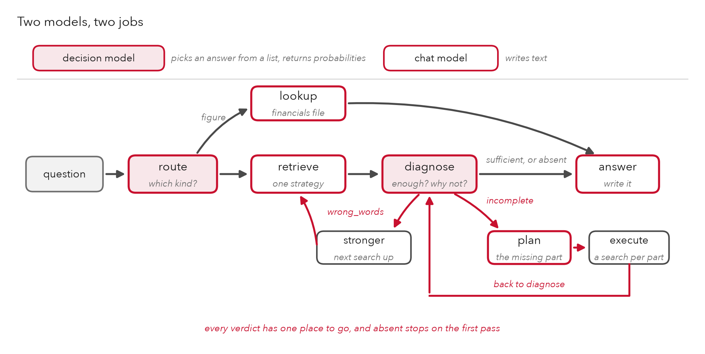
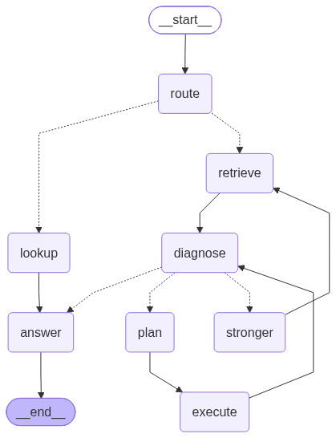

# SEC Filings Agent: Agentic RAG over 10-K filings

A retrieval-augmented agent that answers questions about the 10-K filings of NVIDIA, AMD and Micron. It doesn't use one fixed retrieval pipeline. A **decision model** classifies each question and diagnoses each search result, and then routes to the retrieval strategy that suits that kind of question. A **chat model** is used only for writing: search queries, plans and the final answer.

**Live demo:** https://sec-filings-agent-swmy.onrender.com/
*(Free-tier Render instance. The first question after it has been idle takes about a minute while the instance wakes.)*

---

## The problem: a corpus built to defeat similarity search

The corpus is 27 documents: the Business, Risk Factors and MD&A sections of nine 10-K filings, three fiscal years each from three chip companies. They sell into the same market, so they write about the same things in nearly the same words, every year:

| Phrase | Files that mention it |
|---|---|
| "export control" | 18 of 27 |
| "HBM" | 10 of 27 |
| "artificial intelligence" | 10 of 27 |
| "TSMC" | 9 of 27 |

Ask about *NVIDIA's fiscal 2026 risk factors* and there are 26 other files full of near misses. "Fiscal 2026" is a few tokens averaged into the same vector as everything else, so cosine similarity has no way to prefer the year you asked about. Plain vector search returned the right company in the wrong year (NVDA 2025, NVDA 2024) for 4 of the top 5 results.

The project's central finding is that **no single retrieval strategy wins on every kind of question**. So the agent decides which kind of question it has before it searches.

---

## Architecture



Shaded nodes call the **decision model** (`clef-flash` on Cloudflare Workers AI). It returns a probability for each allowed answer rather than text. Outlined nodes call the **chat model** (Gemini). Each node does one job:

| Node | Model | What it does |
|---|---|---|
| `route` | decision | Classifies the question as `specific` (one company, one year), `comparative` (several companies or years, or none named) or `figure` (a reported number). If the top probability is below `SURE = 0.6`, it falls back to a default strategy. |
| `lookup` | chat | For `figure` questions: names the XBRL concept and reads it from structured financials. It does no search at all, because numbers chunked out of tables are not retrievable. |
| `retrieve` | — | Runs one retrieval strategy (see below). |
| `diagnose` | decision | Judges the passages as `sufficient`, `absent`, `wrong_words` or `incomplete`. An `absent` verdict below `ABSENT_SURE = 0.8` is downgraded to `wrong_words`, so the agent searches again before saying "the filings don't cover that". |
| `stronger` | — | For `wrong_words`: moves up to the next-stronger strategy (`filter` → `filter+rrf` → `filter+rrf+rerank`). |
| `plan` → `execute` | chat | For `incomplete`: the chat model writes one sub-question per missing piece, each naming one company, and runs a filtered search for each. |
| `answer` | chat | Writes the answer from the passages, citing the source filing for each claim. |

Each verdict leads to exactly one next step, and `MAX_ATTEMPTS = 3` caps the loop. The graph is built in LangGraph:

<p align="center"></p>

The deployed app wraps this graph in a `create_agent` chat agent with two tools: `search_filings`, which runs the graph, and `financial_fact`, which reads the XBRL figures. It is served through a Gradio chat UI that shows each tool call as it happens.

### Retrieval strategies

Every strategy has the same contract, `search(question, k) -> [(source_file, passage), ...]`, so they can be compared on equal terms.

| Strategy | How it works |
|---|---|
| `baseline` | Embeds the question as written and runs one dense search with no filter. |
| `filter` | The chat model extracts `{ticker, fiscal_year, search}` from the question. Company and year become a Pinecone metadata filter, and only the topic is embedded. |
| `filter+rrf` | The filter, plus four query rewrites fused with **reciprocal rank fusion** (k = 60). |
| `filter+rrf+rerank` | The above with a pool of 10 candidates, reordered by Cohere's `rerank-v3.5` cross-encoder against the original question. |
| `hybrid+rrf` | Filtered dense search fused with unfiltered **BM25** lexical search. |

---

## Results

All numbers below come from my own runs in the evaluation notebooks. The question sets are small, so read them as directional, not definitive.

### 1. Retrieval strategies on specific questions

6 questions that each name one company and one fiscal year. k = 5.

| Strategy | recall@5 | MRR |
|---|---|---|
| baseline | 0.67 | 0.339 |
| filter | 0.67 | **0.500** |
| filter+rrf | 0.67 | 0.264 |
| filter+rrf+rerank | 0.67 | **0.542** |
| hybrid+rrf | 0.67 | 0.417 |
| baseline+rerank (no filter, pool of 10) | **0.83** | **0.583** |

- **The metadata filter moves the right file up:** MRR rises from 0.34 to 0.50. The average first-relevant rank goes from about 3 to about 2.
- **Fusion hurt once the filter was on.** With the search already narrowed to one filing, a second phrasing has little left to find. RRF rewards agreement between lists, so it can push a single correct passage down.
- **Reranking improves order, not coverage.** On top of fusion, it doubled MRR (0.26 → 0.54) and left recall unchanged. Recall rose in the unfiltered run only because a correct passage at rank 6–10 of the pool was moved into the top 5. A reranker never sees anything outside its pool.

### 2. The same strategies on comparative questions

5 questions that compare companies, span years, or name no filing. Each has several gold files, so k = 10.

| Strategy | recall@10 | MRR |
|---|---|---|
| baseline | **0.83** | **0.562** |
| filter | 0.63 | 0.517 |

**The filter that helped on specific questions hurt here.** A question like "How do AMD and Micron each describe competition?" needs passages from several filings, and a filter narrowed to one company throws them away. Same code, same index, opposite conclusion. This is why the agent routes before it searches.

### 3. Router: decision model vs. chat model

All 24 labeled questions (14 specific, 10 comparative).

| Router | Accuracy | Latency per call |
|---|---|---|
| Decision model (`clef-flash`) | **20 / 24** | **0.68 s** |
| Chat model (Gemini, structured output) | 5 / 24 | 1.60 s |

The chat model's errors were systematic: it labeled most questions `figure`. The description for that label, "a single reported number", also fits questions that ask for an amount such as a fee or a charge, even when the answer is in the prose. Beyond accuracy, the decision model returns a **probability for every option**. That is what makes the agent's two confidence rules possible: falling back below `SURE`, and doubting a weak `absent`. A chat model returns a bare label, so neither rule could be written against it. Decision calls also don't count against the chat model's daily quota.

### 4. Agent: diagnosis graph vs. a fixed escalation ladder

The baseline here is a "ladder" agent. It has no decision model: a chat-model grader climbs one strategy per failure. Both agents were evaluated on 14 questions (8 specific, 6 comparative), and an LLM judge scored the answers.

| Agent | Accuracy | Chat calls / q | Decision calls / q | Seconds / q |
|---|---|---|---|---|
| Ladder | **0.71** | 6.0 | 0.0 | 53.2 |
| Diagnosis (this project) | 0.64 | **3.1** | 2.6 | **16.0** |

The diagnosis agent used **about half the chat calls and under a third of the time**, at a cost of one question of accuracy (10 vs. 9 correct). That gap is within the judge's error. Of the diagnosis agent's two misses that I examined:
- The ZT Systems termination-fee answer was marked down for citing a corpus filename, which is the citation format the answer prompt asks for.
- The AMD competition answer was marked down for describing the September 2025 NVIDIA–Intel partnership. That is a real event inside AMD's fiscal 2025, which the judge treated as a fabrication.

### How different questions take different paths

| Question | Path | Cost |
|---|---|---|
| *What does NVIDIA say about export controls in its fiscal 2026 risk factors?* | specific → `filter` → sufficient → answer | 1 search |
| *What did Micron spend on R&D in fiscal 2025?* | figure → `lookup` → answer ($3,798,000,000, from XBRL) | no search |
| *What is AMD's policy on employee dress code?* | specific → `filter` → **absent (0.91)** → "the filings do not cover that" | 1 search |
| *What factors does NVIDIA believe are its principal competitive factors (FY2025)?* | `filter` → wrong_words → `stronger` → `filter+rrf` → answered | 2 searches |

On the dress-code question, the ladder agent spent 9 chat calls across all three rungs to learn what the diagnosis agent's first verdict already said.

### Takeaways

- **The chat-model router could be removed.** It was less accurate and slower. Even a more accurate version would return only a label, so it couldn't support the probability-based fallback rules the agent depends on.
- **What I would ship:** the diagnosis agent. A one-question accuracy gap, much of it down to the judge, doesn't justify twice the chat calls and over three times the latency under a daily quota.
- **What I'd want to know first:** the real mix of specific, comparative and figure questions, because the starting strategy for each kind was tuned on this split. I'd also want to know how often users name a company and year at all, since the filter strategies only help when they do.

### Evaluation conditions

| Setting | Value |
|---|---|
| Corpus | 27 section files (Items 1, 1A, 7) from 9 10-Ks, plus XBRL financials for 3 companies |
| Chunking | `RecursiveCharacterTextSplitter`, 1,200 chars, 150 overlap, 2,124 chunks |
| Chunk metadata | `source`, `ticker`, `fiscal_year` (int), `section` |
| Embeddings | `qwen3-embedding-0.6b`, 1024 dimensions (built locally with Ollama; queried through Cloudflare Workers AI, which hosts the same model and produces matching vectors) |
| Vector store | Pinecone serverless, cosine |
| Retrieval | k = 5 (k = 10 on comparative questions), rerank pool = 10, RRF k = 60 |
| Reranker | Cohere `rerank-v3.5` |
| Chat model | `gemini-3.5-flash-lite` |
| Decision model | `clef-flash` (Cloudflare Workers AI) |
| Agent thresholds | `SURE = 0.6`, `ABSENT_SURE = 0.8`, `MAX_ATTEMPTS = 3` |
| Metrics | recall@k, MRR over labeled gold files; LLM-as-judge for answer accuracy |

---

## Tech stack

- **LangGraph**: the retrieval graph, with conditional edges and an add-reducer over documents
- **LangChain 1.x**: `create_agent`, tools, structured output with Pydantic
- **Pinecone**: vector search with metadata filters
- **rank-bm25**: in-memory lexical search for hybrid retrieval
- **Cohere Rerank**: cross-encoder reranking
- **Cloudflare Workers AI**: the `clef-flash` decision model and hosted embeddings
- **Google Gemini**: the chat model
- **Gradio**: the chat UI. **Render**: hosting

---

## Project structure

```
app.py              Gradio entry point
agentui.py          chat UI that streams tool calls as they happen
rag/
  config.py         all settings: models, chunking, k, thresholds
  embed.py          Cloudflare Workers AI embeddings client
  decide.py         decision-model client: scope() and diagnose()
  retrieval.py      the five strategies, RRF, BM25, Cohere rerank
  agent.py          the diagnosis graph and the deployed chat agent
  ladder.py         the fixed-escalation baseline agent
  evaluate.py       recall@k, MRR, LLM-judge agent comparison
  util.py           retry with backoff for rate limits
corpus/
  sections/         27 .txt section files
  financials/       XBRL figures per company (.json)
  manifest.csv      company, year and section for each file
eval/
  evalset.json      14 specific questions with gold files
  evalset_hard.json 10 comparative questions with gold files
figures/            architecture diagrams
```

---

## Running locally

```bash
python -m venv .venv && source .venv/bin/activate
pip install -r requirements.txt
```

Create a `.env` file:

```env
GOOGLE_API_KEY=...          # Gemini chat model
PINECONE_API_KEY=...        # vector index
CLOUDFLARE_API_TOKEN=...    # Workers AI permission: decision model + embeddings
CLOUDFLARE_ACCOUNT_ID=...
COHERE_API_KEY=...          # reranking
EMBEDDINGS=cloudflare
```

```bash
python app.py               # http://localhost:7860
```

The app only searches; it never indexes. It expects a Pinecone index named `dada2-1024` (override it with `INDEX_NAME`) that already holds the chunked corpus with the metadata above.

## Deployment

The app deploys to Render as a Blueprint from `render.yaml`. Choose **New + → Blueprint**, pick the repo, and enter the five secret keys when prompted. The build installs `requirements.txt` and starts `python app.py`, which binds to `0.0.0.0:$PORT`.

---

## Limitations and next steps

- **Small evaluation sets.** 6 to 24 questions per comparison, and the agent accuracy comes from an LLM judge with its own errors. A larger labeled set would make the comparisons firmer.
- **Comparative questions can exhaust the attempt cap.** In one trace ("How do AMD and NVIDIA describe their dependence on TSMC?"), the planner's sub-questions kept coming back `incomplete`. The answer covered AMD only. Better sub-question generation in `plan` is the obvious fix.
- **The BM25 arm of hybrid search is unfiltered.** That helps comparative questions and hurts specific ones. A filter-aware lexical index would remove the trade-off.
- **No indexing script in the app.** The index was built offline. A standalone `build_index.py` would make the project reproducible from scratch.
- **Conversation memory is in-process** (`MemorySaver`), so it resets when the server restarts. Each browser session gets its own thread, so refreshing the page starts a new conversation.
